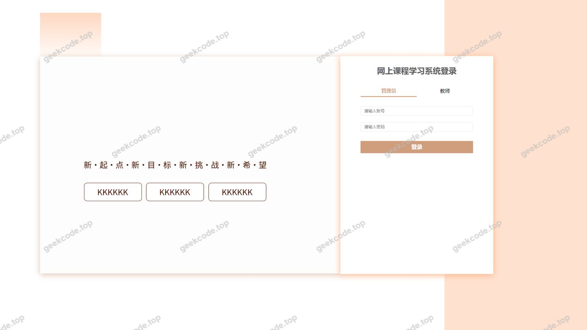
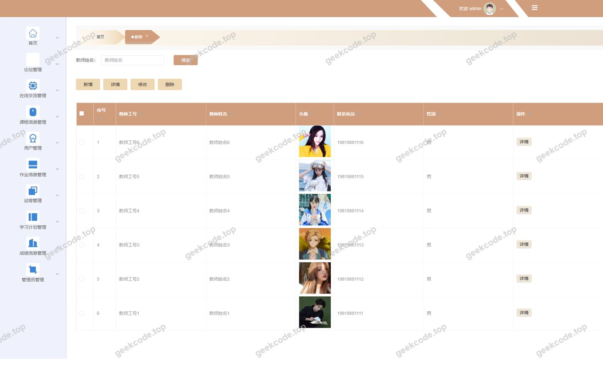
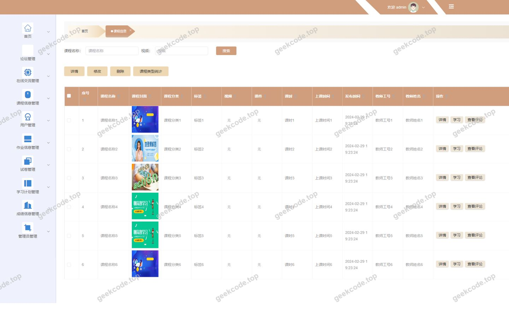
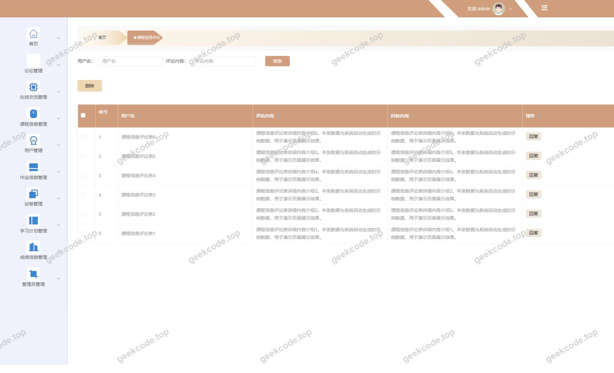
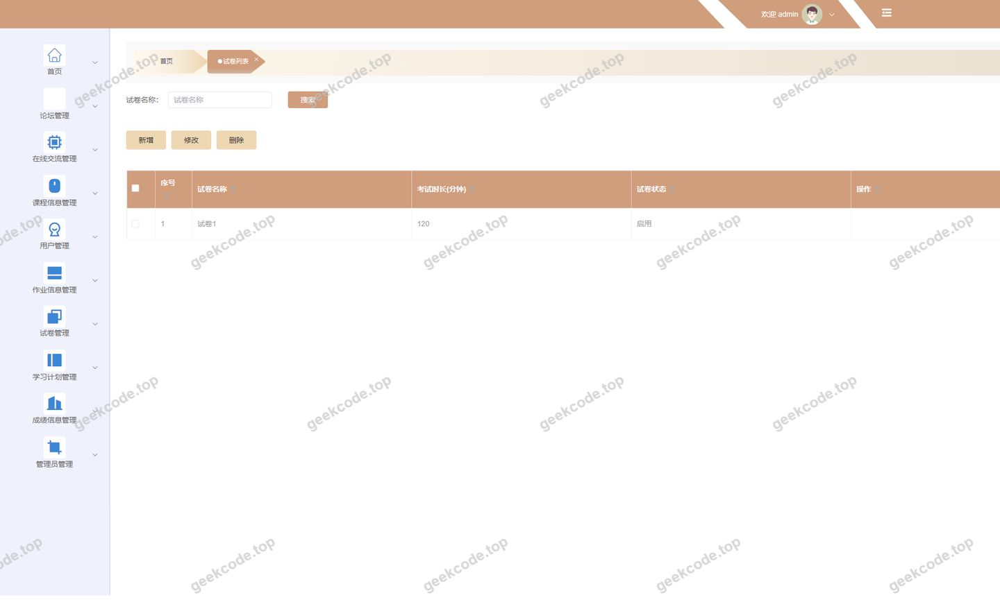
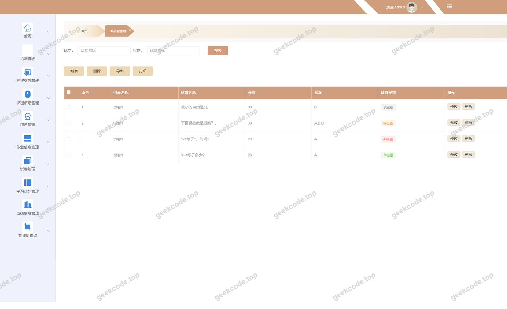
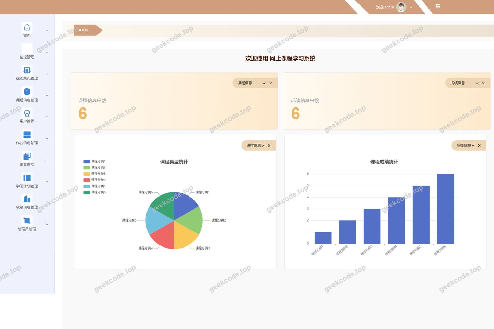
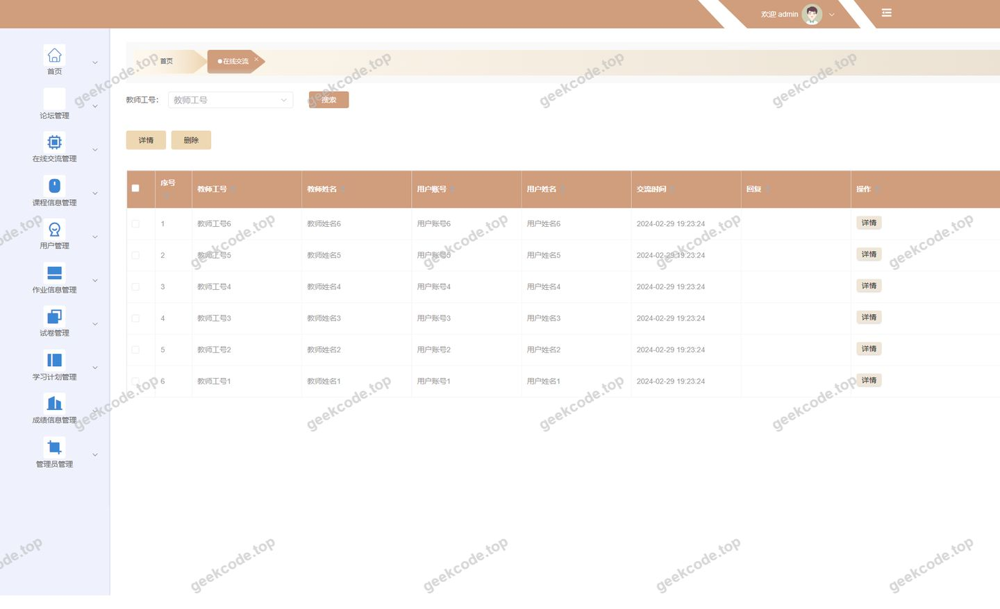

# [springboot]网上课程学习系统

> 🎓 **计算机毕业设计 · [springboot]网上课程学习系统**
>
> 本仓库只放**项目介绍 + 运行截图**（截图是站点带水印的原图，存在仓库 `images/` 里）。
>
> 👉 **完整可运行源码 / 数据库脚本 / 部署文档：[点我获取](https://geekcode.top/archives/springboot-%E7%BD%91%E4%B8%8A%E8%AF%BE%E7%A8%8B%E5%AD%A6%E4%B9%A0%E7%B3%BB%E7%BB%9F?utm_source=github)**
>
> 💬 咨询微信：**ir9372**　|　🌐 更多项目：[极客代码 geekcode.top](https://geekcode.top/?utm_source=github)
>
> 📌 项目详情页：<https://geekcode.top/archives/springboot-%E7%BD%91%E4%B8%8A%E8%AF%BE%E7%A8%8B%E5%AD%A6%E4%B9%A0%E7%B3%BB%E7%BB%9F?utm_source=github>

<table><td width="230" align="center"> <b>扫码加微信 ir9372</b></td><td valign="middle">📦 源码 = 项目介绍 + 全部运行截图 + 数据库 + 部署文档 👉 点上方任意截图，直接跳到 <b>极客代码 geekcode.top</b> 详情页</td></table>

---

<h1>[springboot]网上课程学习系统</h1>
<h2>项目概述</h2>

本项目为“网上课程学习系统”，旨在构建一个集在线课程浏览、视频/文档学习、作业提交、考试测评及师生互动于一体的综合性教育平台。系统采用前后端分离架构，服务于学生（用户）、教师及管理员三类角色。核心功能涵盖课程信息管理、学习进度跟踪、试卷与试题管理、在线交流论坛以及成绩统计等。通过数字化手段解决传统教学中资源分散、反馈滞后等问题，提升学习效率与管理便捷性。技术架构基于 Spring Boot 后端框架，结合 MyBatis-Plus 进行数据持久化，使用 Shiro 实现安全认证与授权，前端采用 Vue 框架开发，确保系统的高内聚低耦合与良好的用户体验。

<h2>技术架构</h2>
<h3>前后端分离架构</h3>

系统严格遵循前后端分离的开发模式：

<ul>
<li><strong>后端服务</strong>：基于 Spring Boot 框架构建 RESTful API 接口。利用 <code>spring-boot-starter-web</code> 提供 Web 服务能力，通过 <code>MyBatis-Plus</code> 简化数据库操作，实现高效的 CRUD 业务逻辑。安全性方面引入 <code>Shiro</code> 框架，负责用户身份认证（Authentication）和权限控制（Authorization），确保不同角色只能访问其授权范围内的资源。</li>
<li><strong>前端应用</strong>：采用 Vue.js 框架开发单页面应用（SPA）。前端通过 Axios 等工具向后端发送 HTTP 请求获取数据，并动态渲染页面。路由配置清晰区分了前台用户视图（如 <code>/index/...</code>）和后台管理视图（如 <code>/jiaoshiCenter</code>, <code>/examquestion</code> 等），实现了界面与数据的解耦。</li>
</ul>
<h3>核心技术选型理由</h3>
<ol>
<li><strong>Spring Boot</strong>：作为微服务基础框架，具备自动配置、起步依赖特性，极大简化了 Java 应用的搭建与部署过程，适合快速迭代开发。</li>
<li><strong>MyBatis-Plus</strong>：在 MyBatis 基础上增强，提供了通用的 CRUD 接口和条件构造器，减少了大量样板代码，提升了开发效率。</li>
<li><strong>Apache Shiro</strong>：轻量级且功能强大的安全框架，易于集成到 Spring 项目中，能够灵活处理复杂的权限模型（如 RBAC），保障系统数据安全。</li>
<li><strong>MySQL</strong>：作为关系型数据库存储核心业务数据（用户信息、课程内容、考试成绩等），配合 JDBC 驱动保证数据读写的高效性与稳定性。</li>
</ol>
<h2>功能模块</h2>

根据后台路由及截图功能列表，系统主要功能模块划分为以下两部分：

<h3>前台用户端功能</h3>

前台主要面向学生和普通注册用户，侧重于内容消费与交互：

<ul>
<li><strong>个人中心</strong>：包括用户列表查看 (<code>/index/yonghuList</code>)、用户详情 (<code>/index/yonghuDetail</code>)、个人信息修改 (<code>/index/yonghuAdd</code>) 及个人中心主页 (<code>/index/yonghuCenter</code>)。支持收藏管理 (<code>/index/storeupList</code>)。</li>
<li><strong>课程浏览与学习</strong>：</li>
<li><strong>课程分类</strong>：查看课程分类列表 (<code>/index/kechengfenleiList</code>) 及详情。</li>
<li><strong>课程信息</strong>：浏览课程详情 (<code>/index/kechengxinxiDetail</code>)，添加新课程记录或笔记 (<code>/index/kechengxinxiAdd</code>)。</li>
<li><strong>课程学习</strong>：进入具体课程学习页面 (<code>/index/kechengxuexiDetail</code>)，查看学习列表。</li>
<li><strong>作业与考试</strong>：</li>
<li><strong>作业管理</strong>：查看作业信息 (<code>/index/zuoyexinxiList</code>)，提交作业 (<code>/index/tijiaozuoyeAdd</code>)，查看作业详情。</li>
<li><strong>成绩查询</strong>：查看个人成绩信息 (<code>/index/chengjixinxiList</code>) 及详情。</li>
<li><strong>互动交流</strong>：</li>
<li><strong>论坛社区</strong>：参与课程讨论 (<code>/index/forumList</code>)，发表帖子。</li>
<li><strong>在线交流</strong>：查看交流列表，促进师生间即时沟通。</li>
<li><strong>学习计划与进度</strong>：</li>
<li><strong>学习进度</strong>：查看和管理个人学习进度 (<code>/index/xuexijinduList</code>)。</li>
<li><strong>学习计划</strong>：制定和查看学习计划 (<code>/index/jihuajindu</code> 对应后台，前台有相关展示入口)。</li>
</ul>
<h3>后台管理端功能</h3>

后台主要面向管理员和教师，侧重于内容管理与数据统计：

<ul>
<li><strong>基础数据管理</strong>：</li>
<li><strong>用户管理</strong>：管理系统内的所有用户账号 (<code>/yonghu</code>)。</li>
<li><strong>教师管理</strong>：维护教师信息资料 (<code>/jiaoshi</code>)。</li>
<li><strong>课程分类管理</strong>：配置课程的分类体系 (<code>/kechengfenlei</code>)。</li>
<li><strong>教学资源管理</strong>：</li>
<li><strong>课程信息管理</strong>：发布、编辑、删除课程详细内容 (<code>/kechengxinxi</code>)。</li>
<li><strong>课程评论管理</strong>：审核和管理用户对课程的评论 (<code>/discusskechengxinxi</code>)。</li>
<li><strong>教学评估管理</strong>：</li>
<li><strong>试卷管理</strong>：创建和维护考试试卷 (<code>/exampaper</code>, <code>/exampaperlist</code>)。</li>
<li><strong>试题管理</strong>：录入、编辑题库中的具体试题 (<code>/examquestion</code>)。</li>
<li><strong>考试记录</strong>：查看学生的考试结果 (<code>/examrecord</code>) 及失败记录 (<code>/examfailrecord</code>)。</li>
<li><strong>作业管理</strong>：发布作业信息 (<code>/zuoyexinxi</code>) 并审阅学生提交的作业 (<code>/tijiaozuoye</code>)。</li>
<li><strong>成绩管理</strong>：录入和统计学生成绩 (<code>/chengjixinxi</code>)。</li>
<li><strong>过程监控与互动</strong>：</li>
<li><strong>学习进度监控</strong>：查看全体学生的学习进度情况 (<code>/xuexijindu</code>)。</li>
<li><strong>学习计划管理</strong>：审核或查看学生的学习计划 (<code>/xuexijihua</code>)。</li>
<li><strong>在线交流管理</strong>：管理论坛帖子及在线交流内容 (<code>/forum</code>, <code>/zaixianjiaoliu</code>)。</li>
<li><strong>系统配置</strong>：</li>
<li><strong>参数配置</strong>：设置系统全局参数 (<code>/config</code>)。</li>
<li><strong>教师中心</strong>：教师专属的工作台入口 (<code>/jiaoshiCenter</code>)，用于集中处理教学事务。</li>
</ul>
<h2>用户角色与权限</h2>

系统基于 Apache Shiro 实现细粒度的权限控制，主要包含以下三种角色：

<table>
<thead>
<tr>
<th align="left">角色</th>
<th align="left">描述</th>
<th align="left">可访问功能模块</th>
</tr>
</thead>
<tbody><tr>
<td align="left"><strong>管理员 (Admin)</strong></td>
<td align="left">系统最高权限拥有者，负责整体运营与维护。</td>
<td align="left"><strong>全部后台功能</strong>：1. 用户与教师管理 (<code>/yonghu</code>, <code>/jiaoshi</code>)2. 课程全生命周期管理 (<code>/kechengxinxi</code>, <code>/kechengfenlei</code>, <code>/discusskechengxinxi</code>)3. 考试与作业全流程管理 (<code>/exampaper</code>, <code>/examquestion</code>, <code>/zuoyexinxi</code>, <code>/tijiaozuoye</code>, <code>/examrecord</code>)4. 成绩与进度监控 (<code>/chengjixinxi</code>, <code>/xuexijindu</code>, <code>/xuexijihua</code>)5. 社区与配置管理 (<code>/forum</code>, <code>/zaixianjiaoliu</code>, <code>/config</code>)6. 登录后台首页 (<code>/admin</code>)</td>
</tr>
<tr>
<td align="left"><strong>教师 (Teacher)</strong></td>
<td align="left">教学内容的主要提供者，负责特定课程的教学管理。</td>
<td align="left"><strong>部分后台功能</strong>（推测基于 <code>/jiaoshiCenter</code> 存在）：1. 教师中心工作台2. 所授课程的信息维护与更新3. 作业发布与批改 (<code>/zuoyexinxi</code>, <code>/tijiaozuoye</code>)4. 试卷与试题管理 (<code>/exampaper</code>, <code>/examquestion</code>)5. 查看学生学习进度与成绩 (<code>/xuexijindu</code>, <code>/chengjixinxi</code>)6. 回复在线交流与评论 (<code>/forum</code>, <code>/discusskechengxinxi</code>)</td>
</tr>
<tr>
<td align="left"><strong>用户/学生 (User)</strong></td>
<td align="left">平台的内容消费者，进行在线学习与互动。</td>
<td align="left"><strong>前台功能</strong>：1. 个人中心与信息维护 (<code>/index/yonghuCenter</code>)2. 课程浏览与学习 (<code>/index/kechengxinxiList</code>, <code>/index/kechengxuexiDetail</code>)3. 作业提交与查询 (<code>/index/tijiaozuoyeAdd</code>, <code>/index/zuoyexinxiList</code>)4. 参加考试与查看成绩 (<code>/index/chengjixinxiList</code>)5. 论坛发帖与交流 (<code>/index/forumList</code>)6. 查看学习进度与计划 (<code>/index/xuexijinduList</code>)</td>
</tr>
</tbody></table>

<em>注：具体教师在前台是否可见部分管理数据，取决于 Shiro 的具体 Realm 配置，但根据路由结构，教师主要通过后台 <code>/jiaoshiCenter</code> 及相关管理路由进行操作。</em>

<h2>项目特色与创新点</h2>
<ol>
<li><strong>闭环式学习管理体系</strong>：系统不仅提供静态的课程资源浏览，还打通了“学习计划 -&gt; 课程学习 -&gt; 作业提交 -&gt; 在线考试 -&gt; 成绩反馈 -&gt; 进度追踪”的全流程。通过 <code>/xuexijindu</code> 和 <code>/xuexijihua</code> 模块，实现了对学生学习过程的量化监控，解决了传统在线教育中过程数据缺失的问题。</li>
<li><strong>灵活的考核机制</strong>：内置了完整的试卷生成与试题库管理系统 (<code>/exampaper</code>, <code>/examquestion</code>)，支持多种题型的组合与在线自动判分（隐含在考试记录管理中），同时结合人工批改的作业模块 (<code>/tijiaozuoye</code>)，形成了客观题与主观题相结合的多元化评价体系。</li>
<li><strong>多维互动社区</strong>：除了常规的问答论坛 (<code>/forum</code>)，还专门设计了“在线交流” (<code>/zaixianjiaoliu</code>) 和“课程评论” (<code>/discusskechengxinxi</code>) 模块，增强了师生之间、生生之间的实时互动与情感连接，提升了用户粘性。</li>
<li><strong>前后端分离的安全架构</strong>：采用 Shiro 进行服务端鉴权，确保 API 接口的安全性；前端 Vue 路由守卫配合后端 Token 验证，有效防止越权访问，保障了用户隐私和数据安全。</li>
</ol>
<h2>部署环境</h2>

为了确保系统的正常运行，需要以下软硬件环境支持：

<ul>
<li><strong>操作系统</strong>：Windows 7/10/11, Linux (CentOS/Ubuntu), macOS。</li>
<li><strong>Java 运行环境</strong>：JDK 1.8 及以上版本。</li>
<li><strong>数据库</strong>：MySQL 5.7 或 MySQL 8.0。需提前创建对应的数据库实例并导入 SQL 脚本。</li>
<li><strong>Web 服务器</strong>：Tomcat 8.5+（若使用 Spring Boot 内置 Tomcat 则无需单独安装，但生产环境建议独立部署或使用 Nginx 反向代理）。</li>
<li><strong>前端构建环境</strong>：Node.js (推荐 LTS 版本，如 v14+)，npm 或 yarn 包管理器。用于编译和打包 Vue 前端项目。</li>
<li><strong>浏览器</strong>：Chrome, Firefox, Edge 等现代主流浏览器。</li>
<li><strong>开发工具（可选）</strong>：IntelliJ IDEA (后端开发), VS Code (前端开发), Navicat (数据库管理)。</li>
</ul>
<h2>五、技术特性</h2>
<ul>
<li>前后端分离架构，前端独立部署</li>
<li>使用 MyBatis-Plus 简化数据访问层开发</li>
<li>集成 Shiro 权限框架实现角色权限控制</li>
</ul>
<h2>六、功能模块截图</h2>
<h3>后台管理端</h3>
<h4>后台-登录页</h4>

<h4>后台-教师</h4>

<h4>后台-课程信息</h4>

<h4>后台-课程信息评论</h4>

<h4>后台-试卷列表</h4>

<h4>后台-试题管理</h4>

<h4>后台首页</h4>

<h4>后台-在线交流</h4>

---

## 获取完整源码

| 项目 | 说明 |
| --- | --- |
| 项目名 | [springboot]网上课程学习系统 |
| 运行截图 | 本文 8 张（站点带水印原图，仓库 `images/` 目录） |
| 完整源码 | [https://geekcode.top/archives/springboot-%E7%BD%91%E4%B8%8A%E8%AF%BE%E7%A8%8B%E5%AD%A6%E4%B9%A0%E7%B3%BB%E7%BB%9F?utm_source=github](https://geekcode.top/archives/springboot-%E7%BD%91%E4%B8%8A%E8%AF%BE%E7%A8%8B%E5%AD%A6%E4%B9%A0%E7%B3%BB%E7%BB%9F?utm_source=github) |
| 咨询微信 | **ir9372**（备注：jingpin-yuanma） |
| 更多项目 | [极客代码 geekcode.top](https://geekcode.top/?utm_source=github) |

> 需要源码、部署、改配置、跑不起来等问题，加微信 ir9372 沟通，说明项目名即可。
